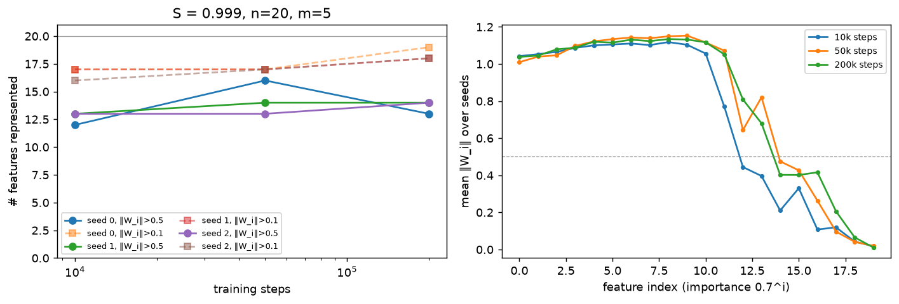
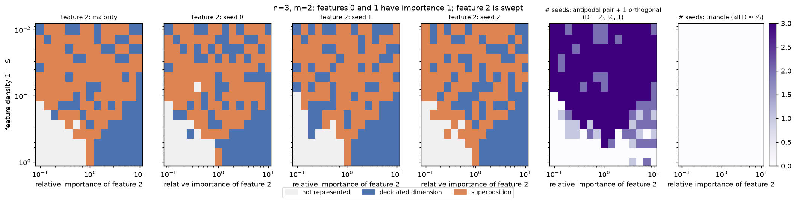
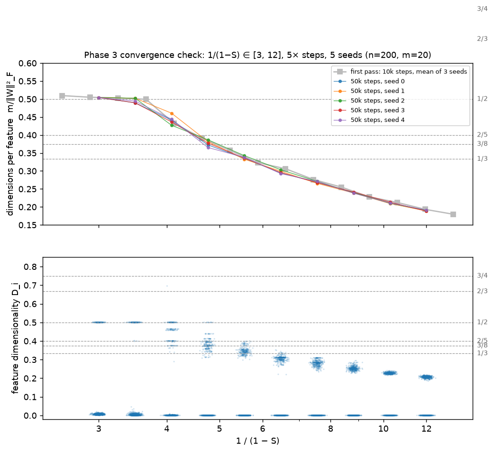

# Toy Models of Superposition — a reproduction

A from-scratch reproduction of Elhage et al. (2022), *Toy Models of Superposition*
([transformer-circuits.pub/2022/toy_model](https://transformer-circuits.pub/2022/toy_model/index.html)),
in PyTorch on an Apple M3 laptop. Every number below is read from `results/*.json`, every figure is
produced by a script in `scripts/`, and `scripts/run_all.sh` regenerates all of it (about 90 minutes on an M3).
Interactive view of the Phase 1 and Phase 3 results: [docs/index.html](docs/index.html) (static, no CDNs).

## Summary

| Phase | What | Headline result | vs. paper |
|---|---|---|---|
| 1 | n=20, m=5, importance 0.7^i, S ∈ {0,…,0.999} | Features with ‖W_i‖>0.5 grow 5 → 13 as S goes 0 → 0.999; W^T W goes identity-block → antipodal pairs → dense | Matches qualitatively; fewer features than the paper at S=0.999, and 20× more steps does not change that |
| 2 | n=2, m=1 phase diagram, 30×30 grid, 3 seeds (+ n=3, m=2 at 15×15) | Three regions as in the paper; empirical vs three-family theory agree on 0.86 of cells (0.94 where seeds are unanimous). n=3, m=2: antipodal pair + orthogonal feature, no triangles | Matches; the extra same-sign solutions are higher-loss local minima |
| 3 | n=200, m=20, uniform importance, 40 sparsities × 3 seeds | Flat plateau at exactly 1/2 dims-per-feature for 1/(1−S) ∈ [2.3, 3.7]; 2/5 only a shoulder; no 3/4 or 2/3. Unchanged at 5× steps, 5 seeds | 1/2 plateau matches; higher-order polytopes do not, and that is not a convergence artefact |
| 4 | |x| task, n=100, m=40 neurons | 40/40 neurons monosemantic at S=0, 0/40 at S=0.99; switch between S=0.9 and 0.97 | Matches |
| 5 | SAE (dict 20) on the Phase 1 hidden activations | Recovers 9/9, 10/10, 10/11 true features at S=0.9/0.97/0.99 (cos>0.9); only 2/5 at S=0 (dense data not identifiable) | Extension; consistent with SAE premise |

Compute: MPS was chosen over CPU after a benchmark on identical data (loss trajectories agree to
1e-7 relative; 5.8 vs 3.3 steps/s on the Phase 3 config). Wall-clock for all phases is about 79 minutes, of which Phase 2 (2700 tiny models on
CPU plus the Monte-Carlo theory step) is 58.

## Reproduction

```bash
uv venv --python 3.12 .venv && source .venv/bin/activate
uv pip install -r requirements.txt
pytest -q                      # 5 tests: shapes, sparsity statistics, hand-computed loss, metrics, top-m sanity check
scripts/run_all.sh             # benchmark + all phases + docs data
```

Individual phases: `python scripts/phase1.py`, `phase3.py`, `phase2.py [GRID] [SEEDS] [STEPS]`,
`phase4.py`, `phase5_sae.py`; each has a matching `plot_*.py` that only reads JSON. `TMS_DEVICE=cpu`
forces the CPU. Phase 3 is checkpointed per seed in `results/phase3_chunks/`.

## Setup common to all phases

Model: `x' = ReLU(W^T W x + b)`, `W ∈ R^{n×m}`. Features: `x_i = 0` with probability `S`, otherwise
`U[0,1]`. Loss: importance-weighted squared error, averaged over batch and features (the paper sums
over features; for fixed `n` that is a constant factor and does not change the optimum). Many models
are trained at once by giving every tensor a leading *instance* dimension, as the original notebook
does; the total loss is the sum over instances so gradients are independent.

Optimiser: AdamW, lr 1e-3, batch 1024, 10 000 steps, 5 % linear warm-up then cosine decay to 0,
Xavier-normal init, zero bias init. Seeds are fixed; three seeds per configuration unless stated.
No hyperparameters were tuned for any phase (`notes/log.md` records the expectations written before
each run and what came out).

## Phase 1 — basic superposition


n=20, m=5, importance `0.7^i`. Top row: `W^T W`; strip: bias; bars: `‖W_i‖` coloured by the paper's
superposition measure `Σ_{j≠i}(Ŵ_i·W_j)²` (black = orthogonal, gold = fully superposed). Seed 0 shown;
counts are over 3 seeds (`results/phase1.json`).

| S | 1/(1−S) | features with ‖W_i‖ > 0.5 (3 seeds) | of which superposed | m/‖W‖²_F | loss |
|---|---|---|---|---|---|
| 0 | 1 | 5, 5, 5 | 0 | 1.00 | 2.3e-3 |
| 0.7 | 3.3 | 5, 7, 7 | 2.7 | 0.80 | 1.9e-3 |
| 0.9 | 10 | 9, 10, 9 | 8.7 | 0.54 | 4.0e-4 |
| 0.97 | 33 | 10, 10, 10 | 10 | 0.49 | 7.3e-5 |
| 0.99 | 100 | 11, 11, 11 | 11 | 0.41 | 2.0e-5 |
| 0.999 | 1000 | 13, 13, 14 | 13.3 | 0.34 | 1.3e-6 |

**Matches the paper.** Dense inputs give exactly the five most important features, orthogonal, with
the other fifteen at zero norm (and bias +0.5, the mean of a dropped feature). From S=0.9 the model
packs more features than dimensions, first as antipodal pairs (−1 off-diagonals in `W^T W`), then
densely; biases of superposed features go negative, as the paper explains (the negative bias
suppresses interference).

**Differs from the paper.** At S=0.999 only 13–14 of 20 features clear the 0.5-norm threshold; the
paper's figure shows nearly all 20. The first pass attributed this to too little gradient in 10k
steps. **Follow-up (convergence check, `results/phase1_convergence.json`, figure below):** rerunning
S=0.999 with 5× and 20× the steps does not change it.

| steps | features with ‖W_i‖ > 0.5 (3 seeds) | with ‖W_i‖ > 0.1 | mean loss |
|---|---|---|---|
| 10 000 | 12, 13, 13 | 17, 17, 16 | 1.23e-06 |
| 50 000 | 16, 14, 13 | 17, 17, 17 | 1.08e-06 |
| 200 000 | 13, 14, 14 | 19, 18, 18 | 1.01e-06 |

The number of fully represented features stays at 13–14; what grows slowly is the number of
*weakly* represented ones (norm between 0.1 and 0.5), and the loss falls by 18 %. So the
shortfall is not a 10k-step artefact: with importance 0.7^i the six or seven least important
features (importance below 0.01) are kept at partial norm. The difference from the paper's panel
therefore more likely comes from a different importance curve or threshold convention than from
under-training. (The 10k baseline in this rerun differs by one feature from the Phase 1 run
because the batch composition changes the per-instance draw.)



## Phase 2 — phase diagram (n=2, m=1)


Two features, one hidden dimension. Feature 0 has importance 1; the x-axis is the importance of
feature 1 relative to it (0.1–10, log), the y-axis the feature density 1−S (1 down to 0.01, log). 30×30
grid, 3 seeds per cell (2700 models trained in one batch, 10k steps each), `results/phase2.json`.
Each model is classified from its weights `W = [W_0, W_1]` with threshold 0.2: feature 1 *not
represented* (|W_1| < 0.2), *dedicated dimension* (|W_0| < 0.2 ≤ |W_1|), or *superposition* (both ≥ 0.2).
The right-most panel is the paper-style theoretical diagram: for every cell the best achievable loss
within each of the three solution families `W ∝ [1,0]`, `[0,1]`, `[1,−1]` (scale and both biases free)
is found by optimising on a fixed 20 000-sample Monte-Carlo estimate of the expected loss, and the
cheapest family wins.

| | not represented | dedicated | superposition |
|---|---|---|---|
| empirical (majority of 3 seeds), fraction of cells | 0.17 | 0.18 | 0.65 |
| theory, fraction of cells | 0.12 | 0.12 | 0.76 |

Agreement between the empirical majority and theory: **0.86** of cells (per seed
0.86, 0.87, 0.86); on the 747 cells where all three seeds
agree with each other, agreement with theory is 0.94.

**Matches the paper.** Dense inputs give a sharp vertical boundary at relative importance 1: the
single dimension goes to whichever feature matters more. Superposition opens as a wedge from
importance ≈ 1 as density falls and, below density ≈ 0.1, covers nearly the whole importance range.
The theory diagram has the same three regions with straight boundaries on log axes, as in the paper,
and the two diagrams agree everywhere except near the boundaries.

**Differs from the paper / caveats.** (i) The empirical diagram has speckled vertical stripes of
single-feature solutions inside the superposition region, around relative importance 0.4–0.6 and
its mirror 2–3. In those cells different seeds land in different local optima (17 % of all cells
are not unanimous), and 26 % of all trained models end with a loss more than 1e-3 above the best
family loss, so part of the disagreement is optimisation rather than the model's true preference.
(ii) 13 % of trained models (344 of 2700) sit in a same-sign solution: both weights with the
*same* sign (e.g. `W ≈ [1.05, 0.35]`) and a negative bias on the stronger feature. They are counted
as "superposition" above. **Follow-up check** (`results/phase2_samesign.json`): these are higher-loss
local minima, not a solution the three-family theory misses. Their loss is above the best family
loss at the same cell in 93 % of cases (median gap 0.0056, median 12× the optimum), and in all
137 cells where another seed found a different solution the same-sign one is worse. By
contrast the trained antipodal models match the theory to Monte-Carlo noise (median gap
-7e-06). (iii) The first version of the theory
computation initialised the biases at zero, where `ReLU(0)` has zero gradient, which under-rated the
single-feature families (agreement 0.77); the log records the fix, and a unit test now pins the
feature-0-only loss at density 1, relative importance 0.16 to r/24. The theory itself is a numerical
optimisation on Monte-Carlo samples rather than the paper's closed-form expressions.

### n=3, m=2 (follow-up, 15×15 grid, 3 seeds)



Features 0 and 1 have importance 1, feature 2 has relative importance r (x-axis); same density axis
and thresholds as above, plus a dedicated-dimension test (feature 2 represented with superposition
measure < 0.1). `results/phase2_n3m2.json`; no theory diagram for this case.

Dense region as expected: feature 2 is dropped for r < 1 and takes one of the two dimensions for
r > 1 (one of the equal features is dropped instead). The sparse region is not a triangle: no model
has all three features at D_i ≈ 2/3. Instead 70 % of all models, and 95 % of those at density
below 0.1, are an antipodal pair plus one orthogonal feature (D_i = ½, ½, 1), which under ReLU has
no positive interference. Which feature is the odd one out depends on the seed, so feature 2 is
labelled "dedicated" or "superposition" essentially at random there (only 55 % of cells are
unanimous across seeds); the speckle in the figure is this degeneracy, not non-convergence.

## Phase 3 — feature geometry


n=200, m=20, uniform importance, 40 values of 1/(1−S) log-spaced in [1, 100], 3 seeds, 10k steps
(`results/phase3.json`, 16 min on MPS). Top: dimensions per feature `m/‖W‖²_F`. Bottom: every
feature's dimensionality `D_i = ‖W_i‖² / Σ_j(Ŵ_i·W_j)²`.

| target fraction | 1 | 3/4 | 2/3 | 1/2 | 2/5 | 3/8 | 1/3 |
|---|---|---|---|---|---|---|---|
| sweep points (of 120) within ±0.02 | 12 | 0 | 0 | 15 | 4 | 5 | 4 |

**Matches the paper.** The curve is 1.00 up to 1/(1−S) ≈ 1.3, drops steeply, and sits on a flat
plateau at 0.50–0.52 for 1/(1−S) ∈ [2.3, 3.7] in all three seeds (seed-to-seed std ≤ 0.004). The
per-feature scatter in that range is a single sharp band at D_i = 1/2: the model represents 40
features as 20 antipodal pairs and drops the other 160 (D_i = 0). This is the "sticky" digon plateau.

**Partially matches.** 2/5 (pentagons) is a shoulder rather than a plateau: for 1/(1−S) ∈ [4.1, 4.6]
the per-feature bands sit at ≈0.40 and ≈0.44 and the curve lingers near 0.39–0.43 for two sweep
points before continuing down. 3/8 and 1/3 are crossed at the speed the sampling grid implies, with
no visible stickiness.

**Differs from the paper.** There are no clusters at 3/4 (tetrahedra) or 2/3 (triangles): the
transition from 1 to 1/2 passes straight through them (single-digit histogram counts,
`figures/phase3_dimensionality_hist.png`). Two further observations: (i) in the dense regime with
*uniform* importance every feature has D_i ≈ m/n = 0.1 even though `m/‖W‖²_F = 1`, because any
20-dimensional subspace is an equally good solution and the model does not single out 20 features;
(ii) at the sparse end all 200 features are represented with norms above 1, so `m/‖W‖²_F` falls to
0.066. The paper's x-axis also stops at 100 and its curve likewise keeps falling.

**Follow-up (convergence check, `results/phase3_convergence.json`).** Rerunning 1/(1−S) ∈ [3, 12]
(10 points) with 5× the steps and 5 seeds leaves the curve where it was: `m/‖W‖²_F` moves by
-0.012 to +0.004 relative to the 10k run (slightly more superposition), with seed-to-seed std ≤ 0.011.
The longest run of consecutive sweep points within ±0.02 of 2/5 is 1 (first pass 1–2), so the
shoulder does not become a plateau with longer training. No per-feature values fall within ±0.02 of
2/3 or 3/4 in either run. Per 1000 feature values in this window, the 1/2 band holds 48 (first pass
33), the 2/5 band 18 (20). Around 1/(1−S) ≈ 4 the scatter splits into discrete bands at 0.50,
0.44, 0.40 and 0.36, a mixture of digons and small polytopes rather than one pentagon phase. The
first-pass figure and numbers above are kept; the rerun is shown separately.



## Phase 4 — computation in superposition (absolute value)


`y = |x|` with `x_i ∈ U[−1,1]` (zero w.p. S), one hidden ReLU layer of m=40 neurons, n=100 features,
importance `0.8^i` (assumed; the paper decays importance but the exact base is not stated in the
text), 2 seeds. Polysemanticity of neuron k is `1 − max_i W1[k,i]² / Σ_i W1[k,i]²`; below 0.1 counts
as monosemantic (`results/phase4.json`).

| S | 0 | 0.5 | 0.8 | 0.9 | 0.97 | 0.99 |
|---|---|---|---|---|---|---|
| monosemantic neurons (mean of 2 seeds) | 40 | 37 | 34.5 | 31.5 | 5.5 | 0 |

**Matches the paper**: dense features give one feature per neuron (pairs of neurons compute
`ReLU(x)` and `ReLU(−x)`), intermediate sparsity gives a mix, and high sparsity makes every neuron
polysemantic. Process note: this phase was launched before its expectation entry was written in
`notes/log.md`; the entry says so.

## Phase 5 — extension: sparse autoencoder on the hidden activations


**Why this extension.** Sparse autoencoders (SAEs) are the main tool that grew out of this paper for
pulling superposed features out of real networks; the toy model is one of the few settings where the
ground-truth features are known, so recovery can be scored exactly.

**Setup.** For each Phase 1 seed-0 model (n=20, m=5) sample `x` from the same distribution, take the
5-dimensional hidden activations `h = W x`, and train an SAE `f = ReLU(W_e (h − b_d) + b_e)`,
`ĥ = W_d f + b_d` with 20 dictionary elements, unit-norm decoder columns, loss `‖h − ĥ‖² + λ‖f‖₁`,
λ ∈ {1e-3, 3e-3, 1e-2, 3e-2, 1e-1}, 5000 steps, batch 4096. A true feature counts as *recovered* if
some decoder column has cosine > 0.9 with its direction `W_i/‖W_i‖`; only features the toy model
represents (`‖W_i‖ > 0.5`) can be recovered. Precision is the fraction of live dictionary elements
whose best-matching true feature has cosine > 0.9. (`results/phase5_sae.json`)

| S | best λ | represented | recovered | mean best cos | precision | L0 | var. unexplained |
|---|---|---|---|---|---|---|---|
| 0 | 0.03 | 5 | 2 | 0.871 | 0.11 | 7.72 | 0.014 |
| 0.7 | 0.03 | 5 | 5 | 0.991 | 0.62 | 4.00 | 0.002 |
| 0.9 | 0.03 | 9 | 9 | 0.991 | 0.68 | 1.60 | 0.001 |
| 0.97 | 0.03 | 10 | 10 | 0.992 | 0.83 | 0.59 | 0.001 |
| 0.99 | 0.1 | 11 | 10 | 0.981 | 0.85 | 0.23 | 0.016 |
| 0.999 | 0.1 | 13 | 9 | 0.918 | 0.73 | 0.04 | 0.029 |

**Result.** In the superposition regime (S = 0.9–0.99) the SAE recovers all, or all but one, of the
9–11 features the toy model packs into 5 dimensions, with cosines of 0.98–0.99, at λ = 0.03–0.1. Too
small a λ gives a dense, unaligned dictionary (0–3 features, precision ≈ 0.1). Recovery degrades at
S = 0.999 (9 of 13, mean cosine 0.92), where the weakest features fire a handful of times per
evaluation batch. The instructive failure is S = 0: the five features are orthogonal and `h` is
exactly five-dimensional, yet only 2 of 5 are recovered. With dense inputs every rotation of the basis
reconstructs `h` equally well and the L1 term has little to select on (L0 stays at 6–12 of 20), so the
dictionary is not identifiable. Sparsity in the data, not merely a sparsity penalty, is what lets an
SAE find the true basis.

## Deviations and limitations

- Loss is averaged over features rather than summed (constant rescaling for fixed n; Adam is scale invariant).
- Training data is sampled on the training device with a seeded device generator, so CPU and MPS runs
  are each reproducible but do not see identical data streams. The benchmark compares them on identical CPU-sampled data.
- 10k steps for every phase in the first pass. Follow-up runs at 5× (Phase 3) and 5×/20× (Phase 1,
  S=0.999) did not change the Phase 1 count or the Phase 3 plateau structure, so neither is a
  10k-step convergence effect as far as these runs show.
- Phase 3 uses n=200, m=20; the paper's figure uses a comparable but not identical configuration, and
  the exact numeric plateau extents are not expected to transfer.
- Phase 4 importance base (0.8) is an assumption. Phase 2 thresholds (|W| < 0.2) and Phase 1/5
  thresholds (0.5 norm, 0.9 cosine) are my choices, stated in the JSON.
- Three seeds per configuration (two for Phase 4); errors are seed ranges, not confidence intervals.

## Repository layout

```
tms/            model.py (ToyModel, data, loss), train.py (loop, device), analysis.py (metrics), plotting.py
scripts/        phase1.py … phase5_sae.py, plot_*.py, benchmark.py, export_docs.py, run_all.sh
tests/          pytest suite
results/        JSON written by the scripts (+ small .npz with weights)
figures/        PNGs written by plot_*.py
docs/           static site (index.html + data.js), deployed by .github/workflows/pages.yml
notes/          log.md (dated decisions, expectations vs. outcomes), progress.md (resume point)
```

## Citation

Elhage, N., Hume, T., Olsson, C., Schiefer, N., Henighan, T., Kravec, S., Hatfield-Dodds, Z., Lasenby, R.,
Drain, D., Chen, C., Grosse, R., McCandlish, S., Kaplan, J., Amodei, D., Wattenberg, M., Olah, C. (2022).
*Toy Models of Superposition*. Transformer Circuits Thread.
https://transformer-circuits.pub/2022/toy_model/index.html
